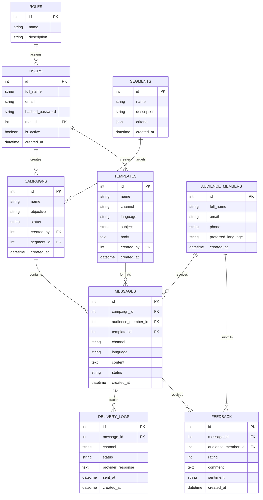

# NexaReach — Entity Relationship Diagram

**Project:** AI-Powered Multilingual Public Awareness and Mass Communication Platform

## Database Entities and Relationships

## Notes

- **Roles and Users:** Each user can be assigned a role.
- **Campaigns:** Users create campaigns, and campaigns can target audience segments.
- **Templates and Messages:** Templates provide content formats for messages sent to audience members through campaigns.
- **Delivery Logs:** Track message delivery status and provider responses.
- **Feedback:** Audience members can submit feedback on messages.
- **Multilingual Support:** Templates and messages include language fields.
